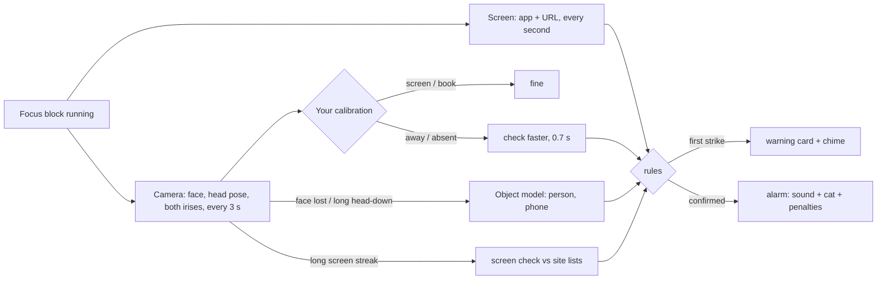

# LockIn

Local study focus tracker for Windows. A small always-on-top timer bar runs your pomodoro and watches
for distraction in layers: cheap checks run all the time, heavier ones only when something looks off.
Nothing leaves your machine. Camera frames are analysed in memory and never saved. The screen layer
never captures pixels.

## What you see

- **Timer bar** (always on top): clock, status ("On your book", "Back in 1:42", "Distracted"), and
  buttons for start/pause, step away, the CAT calculator and the main window, and a ring that fills as the block runs. Drag it anywhere; set its resting opacity in Settings → Shortcuts (it turns fully visible on hover);
  double- or right-click opens the main window. Ctrl+Alt+L makes it click-through.
- **Main window** (Ctrl+Alt+O): your live camera with the tracking drawn over it — eye outlines,
  irises, a gaze arrow and a plain-language label ("Looking at your book", 87 %). Below it the session
  clock, start / step-away buttons and today's numbers. Settings slide in from the right. A short
  spotlight tour runs on first open and replays from the question mark. "Hide the camera picture"
  shows only the tracking lines (screen sharing).
- **Alert cards**: warnings, alarms and questions with painted cats (scuba cat and friends) or your
  own GIFs, plus a built-in or custom sound.
- **CAT calculator** (Ctrl+Alt+C): 1:1 port of the TCS iON Normal Calculator from CAT Prep
  (`dashboard-app/lib/cat-calculator.mjs`), same quirks and test cases.

## How it decides



- **Gaze**: YuNet finds the face and 5 points; the MediaPipe iris model reads each eye (contour,
  iris centre, openness). Twelve features (head yaw/pitch/roll, iris x/y per eye, eye openness, face
  size and position) feed a small per-user classifier trained by calibration.
- **Calibration** (main window → Calibrate, ~15 s): follow a dot that lands on each spot with a soft note (beats keep time on the other steps), read your book, then
  look around the room. Redo it when you move the laptop. Uncalibrated, LockIn falls back to head pose.
- **Sites**: the first visit to a blocked site warns; the second visit, or staying past the limit,
  rings the alarm. Ask-sites (YouTube, Reddit) get "for study or distraction?". App names such as
  `discord.exe` work too.
- **Stepping away** (Ctrl+Alt+B): pauses timer and monitoring without alarms; come back in time or the
  alarm rings. Optional auto-resume when the camera sees you working again.
- **Penalties** (each a switch): extra focus time (doubling, capped), timer waits for you, score
  points, clean-block streak, late return from a pause.

## Shortcuts

| Keys | Action |
|---|---|
| Ctrl+Alt+P | Start / pause |
| Ctrl+Alt+B | Step away / I'm back |
| Ctrl+Alt+C | CAT calculator |
| Ctrl+Alt+O | Main window |
| Ctrl+Alt+L | Timer bar click-through on/off |

## Resource use

Measured on the release build (HP laptop, integrated GPU, 150 % scaling). "All processes" includes the
WebView2 helpers that exist only while the main window is open. CPU is the share of all cores.

| State | LockIn private | All processes private | CPU |
|---|---|---|---|
| Timer bar only, paused | 37 MB | 37 MB | 0.0 % |
| Focus block, worst case (no face: fast checks + object model) | 51 MB | 51 MB | 0.6 % |
| Focus block + main window open with live preview | 57 MB | 208 MB | 3.5 % |
| Main window closed again | 46 MB | 46 MB | 0.0 % |

Closing the main window ends its WebView2 processes. It runs without a GPU process and with a single
renderer to stay small. Per check: face + both eyes 17–35 ms, object model ≈ 100–150 ms (one core).

## Build and run

Rust (GNU toolchain; MSVC works too) plus a C toolchain for `tract`'s assembly kernels (MinGW gcc).

```
cargo build --release
target\release\lockin.exe
```

The main window uses WebView2 (built into Windows 11). With the GNU toolchain the exe loads
`WebView2Loader.dll` at start-up; `build.rs` copies it from `vendor/` next to the exe, so ship the two
files together.

Diagnostics (print only, nothing saved):

- `lockin --diag` runs 10 s of live camera: face, eyes, head pose, gaze label, person/phone, timings.
- `lockin --diag img1.jpg img2.png` runs the same on images.
- `lockin --diag-screen` prints what the screen layer sees (app, title, URL) for 15 s.

Data lives in `%APPDATA%\LockIn` (`settings.json`, `stats.json`, `memes\`, `webview\`).

## Development

`powershell -ExecutionPolicy Bypass -File scripts/dev.ps1` builds and launches, then rebuilds and
relaunches on changes to `src/`, `assets/`, `models/` or `Cargo.toml` (debounced 1 s). The running copy
lives in `run/` so builds never hit a locked exe; a failed build keeps the old app running. `-Release`
builds release, `-Once` builds and launches without watching. Close any other LockIn first (single
instance). For throwaway settings set `$env:APPDATA = Join-Path $env:TEMP 'LockIn-dev'` before starting.

Debug builds serve `assets/` from disk: edit HTML/CSS/JS and press F5 in the main window.

## Limits

- The book pose needs the camera to still see your face while you read; if it can't, the person check
  stops "head down at the desk" from counting as absent.
- No pen detection: COCO detectors have no pen class. Phones and people are detected.
- URL reading uses UI Automation on Chromium browsers and Firefox; otherwise tab titles are used for
  known sites.

## Credits

- YuNet face detector (OpenCV Zoo, MIT); input shape relaxed for 256×192.
- MediaPipe Iris landmark model (Apache-2.0), ONNX conversion via PINTO_model_zoo; see `models/iris.NOTICE`.
- NanoDet-Plus (OpenCV Zoo, Apache-2.0).
- Icons: [Phosphor](https://phosphoricons.com) (MIT), subset in `assets/fonts/`.
- Inference: [tract](https://github.com/sonos/tract). Native UI: [egui](https://github.com/emilk/egui).
  Main window: [wry](https://github.com/tauri-apps/wry) on WebView2.
