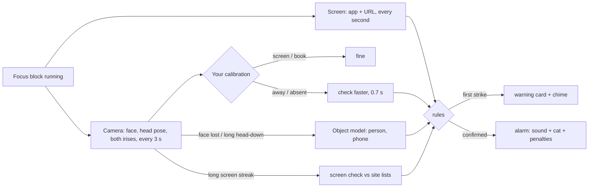

# LockIn

Local study focus tracker for Windows. A small always-on-top timer bar runs your pomodoro and watches
for distraction in layers: cheap checks run all the time, heavier ones only when something looks off.
Nothing leaves your machine unless you send feedback from the main window. Camera frames are
analysed in memory and never saved. The screen layer never captures pixels.

[](https://github.com/shymonke/lockin/releases/download/v0.1.0/lockin-demo.mp4)

**[Download for Windows](https://github.com/shymonke/lockin/releases/latest)**: unzip and run `lockin.exe`
(needs the WebView2 runtime, built into Windows 10 and 11).

## What you see

- **Timer bar** (always on top): clock, status ("On your book", "Back in 1:42", "Distracted"), and
  buttons for start/pause, step away, camera on/off, the calculator and the main window, and a ring that fills as the block runs. Drag it anywhere; Settings → Timer bar sets its theme (Glass by
  default, Slate, Midnight), resting opacity (fully visible on hover) and fold delay. Double- or right-click
  opens the main window. Click-through (Settings → Timer bar, or a shortcut you bind) lets clicks
  pass to the window below until you turn it off or restart LockIn. After a few idle seconds it folds into
  a ball drawn like the LockIn mark: a clock ring that fills with the phase (green focus, blue
  break), a hand at its end, and the calibration ball's blue in the middle (amber looking away, red
  on a blocked site or alarm); Settings → Timer bar → Clock around the ball turns the ring and hand
  off. Hovering the ball, or an alert, unfolds it, and alert cards grow out of the
  ball. Minimising (Win+M, Win+D) never hides it.
- **Tray icon**: click opens the main window; right-click for start/pause, step away, the
  calculator, click-through and Quit, each with its current shortcut. LockIn has no taskbar button:
  minimising the main window tucks it into the tray.
- **Main window** (Ctrl+Alt+O, which also brings the timer bar back): fits the window without
  scrolling. On the left, your live camera at its own aspect ratio (nothing cropped) with the
  tracking drawn over it — eye outlines, irises, a gaze arrow and a plain-language label ("Looking at
  your book", 87 %) — and the year's pomodoro heatmap under it. On the right the session clock,
  start / step-away buttons, today's numbers, and the task and idea lists, which scroll inside
  their cards. Below 860 px wide the columns stack.
  Settings slide in from the right. The header links to LockIn on GitHub and, in builds that carry a
  feedback webhook, opens a feedback form that posts to the developer's Discord (message, optional
  contact, app version; mentions disabled). A short spotlight tour runs on first open and replays from the
  question mark. "Hide the camera picture" shows only the tracking lines (screen sharing). With the
  camera off the preview stops too and the camera is released (its light goes out).
- **Alert cards**: warnings, alarms and questions with painted cats (scuba cat and friends) or your
  own GIFs, plus a built-in or custom sound.
- **Tasks** (Pomodoro style): one list for the day, each task with an estimate in pomodoros. The
  active task sits on the timer bar with its pomodoro dots (filled = done, hollow = still estimated,
  amber = over the estimate), a check-off button and "+" for quick add (a Task/Idea chip or
  Shift+Enter files it as a side idea for after studying). When a focus block ends, LockIn asks
  "Done with …?" (Done, or carry it into the next block); ticking a task off mid-block makes the next
  one active straight away. Distraction alarms are counted against the active task.
- **History**: a GitHub-style year of focus days in the main window (pomodoros per day, streak).
  Tasks, ideas and history live in `tasks.json` next to the settings.
- **Calculator** (Ctrl+Alt+C): a small on-screen calculator with memory keys, styled like the basic
  calculators used in computer-based tests.

## How it decides



- **Gaze**: YuNet finds the face; MediaPipe Face Landmarker reads a 478-point mesh on it (eye
  outlines, irises, head pose) and 52 blendshapes (eye-look up/down/in/out). Fifteen features (head
  yaw/pitch/roll, iris x/y per eye, eye openness, face size and position, horizontal and vertical eye
  look, gaze pitch) feed a small per-user classifier trained by calibration. While the main window
  previews (12 fps) and during calibration, each frame's crop comes from the previous mesh and YuNet
  only runs to find the face again; those frames also update the timer bar's label, and a changed
  label is re-checked within 0.7 s instead of waiting for the next interval.
- **Phone and person**: RTMDet-tiny (COCO) runs only when the face is lost or the head has been down
  for a while; two phone sightings in a row ring the phone alarm.
- **Calibration** (main window → Calibrate, ~20 s): the main window steps aside and the timer bar
  folds into a ball that tours the whole screen, a soft note on each spot; when it rests in the
  middle, tip your head toward the keyboard and back with your eyes on it. Then read your book and
  look around the room. Redo it when you move the laptop. Uncalibrated, LockIn falls back to head pose.
  The camera stays on through each step, also while the main window steps aside and with the camera
  switch off. No step samples before the camera delivers frames and the face models have read one:
  the ball breathes at its first spot, the book and away steps say "Starting the camera…".
  Calibrations saved by older versions (different features) are dropped on start; calibrate again.
- **Eyes first**: the classifier weights iris position, eyelids, eye-look, gaze pitch and gaze yaw
  (head angle plus the eyes' turn in the head) above head angles and face size/position, so tipping
  or turning your head, or leaning in, while your eyes stay on the screen stays "screen". Gaze yaw is
  derived from the stored features, so existing calibrations keep working. Settings → Camera →
  "Decide by: Gaze only" uses nothing but the two gaze angles and eyelid openness (for comparing),
  and skips the blendshape model on live checks (calibration still runs it, so one calibration
  serves both modes). The mesh itself can't be trimmed: the gaze angles come from its iris and
  eyelid points, and the network computes all 478 points in one pass. The main window's readout
  shows the live gaze yaw and pitch, and under Check this frame's time plus the 5th–95th percentile
  range of the last ~3 s.
- **Sites**: the first visit to a blocked site warns; the second visit, or staying past the limit,
  rings the alarm. Ask-sites (YouTube, Reddit) get "for study or distraction?". App names such as
  `discord.exe` work too.
- **Stepping away** (Ctrl+Alt+B): pauses timer and monitoring without alarms; come back in time or the
  alarm rings. Optional auto-resume when the camera sees you working again.
- **Penalties** (each a switch): extra focus time (doubling, capped), timer waits for you, score
  points, clean-block streak, late return from a pause.

## Shortcuts

Defaults below; rebind any of them in Settings → Shortcuts. A shortcut can be a key combo or a mouse
input: wheel up/down, middle click, or the side buttons (Mouse 4 / 5), with or without modifiers.
Key combos use `RegisterHotKey`; mouse shortcuts use a low-level mouse hook that is installed only
while one is bound, or while Settings records a shortcut (middle and side buttons are captured
there, since the page itself never receives Mouse 4). A bound mouse input is consumed (a bare
wheel-down binding stops scrolling).

| Keys | Action |
|---|---|
| Ctrl+Alt+P | Start / pause |
| Ctrl+Alt+B | Step away / I'm back |
| Ctrl+Alt+C | Calculator |
| Ctrl+Alt+K | Camera on/off (screen checks keep running) |
| Ctrl+Alt+O | Main window (and show the timer bar) |
| (none) | Timer bar click-through on/off; unbound by default so it cannot be turned on by accident |

**Start with Windows** (Settings → Shortcuts → Windows) adds a per-user Run entry for the exe you
started; it is rewritten on every start, so sign-in launches the build you ran last.

## Resource use

Measured on the release build (HP laptop, integrated GPU, 150 % scaling) with the previous models
(Iris + NanoDet); the per-check times below are for the current ones. "All processes" includes the
WebView2 helpers that exist only while the main window is open. CPU is the share of all cores.

| State | LockIn private | All processes private | CPU |
|---|---|---|---|
| Timer bar only, paused | 37 MB | 37 MB | 0.0 % |
| Focus block, worst case (no face: fast checks + object model) | 51 MB | 51 MB | 0.6 % |
| Focus block + main window open with live preview | 57 MB | 208 MB | 3.5 % |
| Main window closed again | 46 MB | 46 MB | 0.0 % |

Closing the main window ends its WebView2 processes. It runs without a GPU process and with a single
renderer to stay small. Per check (release, 1280×720): face + mesh + blendshapes 45–50 ms, object
model 145–160 ms (one core).

## Build and run

Rust (GNU toolchain; MSVC works too) plus a C toolchain for `tract`'s assembly kernels (MinGW gcc).

```
cargo build --release
target\release\lockin.exe
```

The main window uses WebView2 (built into Windows 11). With the GNU toolchain the exe loads
`WebView2Loader.dll` at start-up; `build.rs` copies it from `vendor/` next to the exe, so ship the two
files together.

Diagnostics (print only, nothing saved):

- `lockin --diag` opens the live camera, prints its warm-up frames' brightness, one full report (face,
  mesh, head pose, eye look, gaze label, person/phone), then each stage's time over 60 frames at the
  preview's 12 fps (min, median, p95, max, spread). The app must be closed: it holds the camera.
- `lockin --diag img1.jpg img2.png` prints that report for each image, then the stage times on the
  last one.
- `lockin --diag-screen` prints what the screen layer sees (app, title, URL) for 15 s.

Data lives in `%APPDATA%\LockIn` (`settings.json`, `stats.json`, `memes\`, `webview\`), outside the
app folder, so a new build reads the same settings; settings it has never seen take their defaults.
A file it cannot read is kept as `settings.json.unreadable` before defaults replace it. If LockIn
crashes, the panic message is appended to `crash.log` there.

**Feedback webhook.** The Discord webhook URL is baked in at build time from the
`LOCKIN_FEEDBACK_WEBHOOK` environment variable or a git-ignored `feedback-webhook.txt` in the repo
root; without either the feedback button is hidden. Anyone holding a release exe can extract the
URL, so treat it as public and delete/recreate the webhook in Discord if it is abused.

## Development

`powershell -ExecutionPolicy Bypass -File scripts/dev.ps1` builds and launches, then rebuilds and
relaunches on changes to `src/`, `assets/`, `models/` or `Cargo.toml` (debounced 1 s). The running copy
lives in `run/` so builds never hit a locked exe; a failed build keeps the old app running. `-Release`
builds release, `-Once` builds and launches without watching. Close any other LockIn first (single
instance). For throwaway settings set `$env:APPDATA = Join-Path $env:TEMP 'LockIn-dev'` before starting.

Debug builds serve `assets/` from disk: edit HTML/CSS/JS and press F5 in the main window.

### Demo video

1. `powershell -ExecutionPolicy Bypass -File scripts/demo.ps1` (needs FFmpeg on PATH and a release
   build in `target-fast`). It closes LockIn, covers the screen with a plain backdrop, records it while
   `lockin --demo` plays every feature on a fixed ~80 s timeline, then restarts LockIn. The demo runs on
   a throwaway data folder (`%TEMP%\LockIn-demo`), so your settings, tasks and stats are untouched; it
   moves the mouse itself. Sit in front of the camera and follow the calibration ball with your eyes.
   Footage lands in `demo-video/assets/footage/` (git-ignored).
2. `cd demo-video && node build.mjs` turns the footage into a HyperFrames composition: one sped-up,
   reframed clip per scene with its caption, plus the intro and end cards. Shot framing and speeds
   are the `SHOTS` table in `build.mjs`; captions come from the demo's script in `src/app/demo.rs`.
3. `npm run dev` previews it in the browser; `npm run render` writes the MP4.

## Limits

- The book pose needs the camera to still see your face while you read; if it can't, the person check
  stops "head down at the desk" from counting as absent.
- No pen detection: COCO detectors have no pen class. Phones and people are detected.
- URL reading uses UI Automation on Chromium browsers and Firefox; otherwise tab titles are used for
  known sites.

## Credits

Model sources, licenses and conversions: `models/NOTICE.md`; `scripts/fetch_models.py` rebuilds them.

- YuNet face detector (OpenCV Zoo, MIT); input shape relaxed for 256×192.
- MediaPipe Face Landmarker: face mesh and blendshape models (Google, Apache-2.0), converted to ONNX.
- RTMDet-tiny (OpenMMLab, Apache-2.0), cut before NMS.
- Icons: [Phosphor](https://phosphoricons.com) (MIT), subset in `assets/fonts/`.
- Inference: [tract](https://github.com/sonos/tract). Native UI: [egui](https://github.com/emilk/egui).
  Main window: [wry](https://github.com/tauri-apps/wry) on WebView2.
