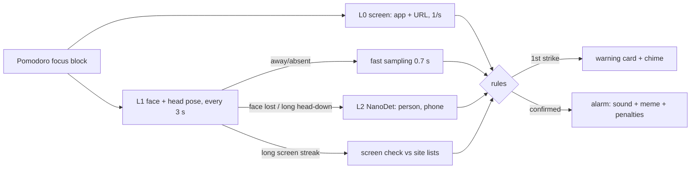

# LockIn

Local study focus tracker for Windows. A small always-on-top pill runs your pomodoro and watches for
distraction in layers: cheap checks run all the time, heavier ones only when something looks off.
Nothing leaves your machine. Camera frames are analysed in memory and never saved. The screen layer
never captures pixels.

## Features

- **Pomodoro pill**: always on top, draggable, can be click-through (Ctrl+Alt+L). Focus/short/long breaks, auto-start options, daily goal.
- **BRB pause** (Ctrl+Alt+B): freezes the timer and monitoring for a set time (default 2 min) with no alerts. Press again or *I'm back* to resume where you left off. Overrun it and the alarm goes off. Optional auto-resume when the camera sees you back at work.
- **Site/app watch**: the first visit to a blocked site (x.com, instagram.com, …) shows a warning. The second visit, or staying past the limit, sets off the alarm. *Ask* sites (YouTube, Reddit) get a "study or distraction?" question, remembered if you tick it. App names such as `discord.exe` work too.
- **Camera layers** (head pose, not eye tracking):
  - L1: YuNet face detector (230 KB) gives face presence and head pose, reported as screen / book / away / absent after calibration.
  - Escalation: when you look away or vanish, sampling speeds up. NanoDet (3.8 MB, COCO) then checks for a person (head-down reading, not away) or a **phone** (also checked periodically while your head is down).
  - A long screen streak triggers a screen check against your site lists.
  - Posture hint when you lean into the screen (face size vs calibration).
- **Penalties** (each toggleable): add focus time (optionally escalating and capped), hold the timer while distracted, lose score points, reset the clean-block streak, count BRB overruns.
- **Alerts**: card with animated painted cats (scuba cat, judging cat, sleepy cat, alarm cat) or your own GIF/PNG/JPG. Built-in synthesised sounds or your own MP3/WAV. Optional brainrot copy.
- **CAT calculator** (Ctrl+Alt+C): 1:1 port of the TCS iON Normal Calculator from CAT Prep (`dashboard-app/lib/cat-calculator.mjs`), with the same quirks and test cases. Movable, always on top, keyboard input.
- **Guided tour** on first run, replayable from Settings → *Take the tour*.
- **Stats**: daily focus time, score, warnings/distractions, clean-block streak, daily-goal streak, 14-day chart.



## Shortcuts

| Keys | Action |
|---|---|
| Ctrl+Alt+P | Start / pause |
| Ctrl+Alt+B | BRB pause / I'm back |
| Ctrl+Alt+C | CAT calculator |
| Ctrl+Alt+O | Settings (or right-click the pill) |
| Ctrl+Alt+L | Pill click-through on/off |

## Resource use

Measured on the release build (HP laptop, integrated GPU, 150 % scaling). CPU is the share of all cores.

| State | Working set | Private | CPU |
|---|---|---|---|
| Idle, timer paused | 65 MB | 36 MB | 0.03 % |
| Focus block, worst case (no face: fast sampling + L2 every few s) | 99 MB | 48 MB | 1.1 % |
| Alarm card animating | 98 MB | 46 MB | 1.3 % |
| Paused again (camera and models released) | 91 MB | 42 MB | 0.04 % |

Model cost per frame: L1 ≈ 20 ms, L2 ≈ 110 ms (single core). Most of the idle working set is the OpenGL driver.

## Build

Rust (GNU toolchain works; MSVC too) plus a C toolchain for `tract`'s assembly kernels (MinGW gcc for GNU).

```
cargo build --release
target\release\lockin.exe
```

Diagnostics (print only, nothing saved):

- `lockin --diag` runs 10 s of live camera with face/pose/person/phone scores and timings.
- `lockin --diag img1.jpg img2.png` runs the same on images.
- `lockin --diag-screen` prints what the screen layer sees (app, title, URL) for 15 s.

Data lives in `%APPDATA%\LockIn` (`settings.json`, `stats.json`, `memes\`).

## Development

Run `powershell -ExecutionPolicy Bypass -File scripts/dev.ps1` to build and launch,
then rebuild after changes to `src/`, `assets/` (including when created later),
`models/`, or `Cargo.toml`. Changes debounce for one second. A successful build
replaces the script's running app using `run/lockin.exe`; a failed build prints
the error tail and keeps the previous app running. Close any separately launched
LockIn first, since the app permits only one instance.

Add `-Release` for release builds, or `-Once` for one build and launch without
watching. Both modes stay attached until Ctrl+C (which stops the app and watcher);
`-Once` also returns when the app exits. PowerShell 5+ is supported. If Cargo is
missing from PATH, the script adds the local GNU Rust and MinGW toolchain paths.
To use disposable settings, set `$env:APPDATA = Join-Path $env:TEMP 'LockIn-dev'`
before starting the script.

## Limits

- Gaze means head pose from 5 face landmarks, not iris tracking. Calibrate both poses for your setup.
- On laptops the book pose works only if the camera still sees your face while reading. Otherwise L2's person check keeps "head down at the desk" from counting as absent.
- No pen detection: COCO detectors have no pen class. Phone and person are detected.
- URL reading uses UI Automation on Chromium browsers and Firefox. If a browser hides its address bar, tab titles are used for known sites.

## Credits

- YuNet face detector (OpenCV Zoo, MIT); the input shape was relaxed for 256×192.
- NanoDet-Plus (OpenCV Zoo, Apache-2.0).
- Inference: [tract](https://github.com/sonos/tract). UI: [egui](https://github.com/emilk/egui).
